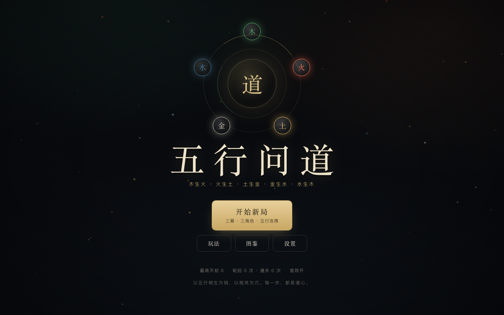
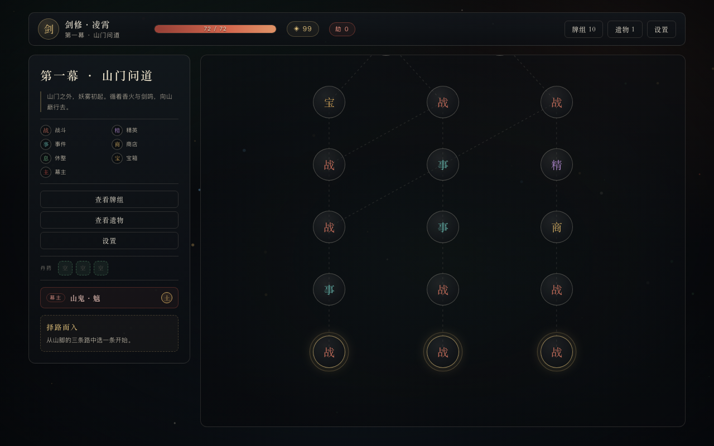
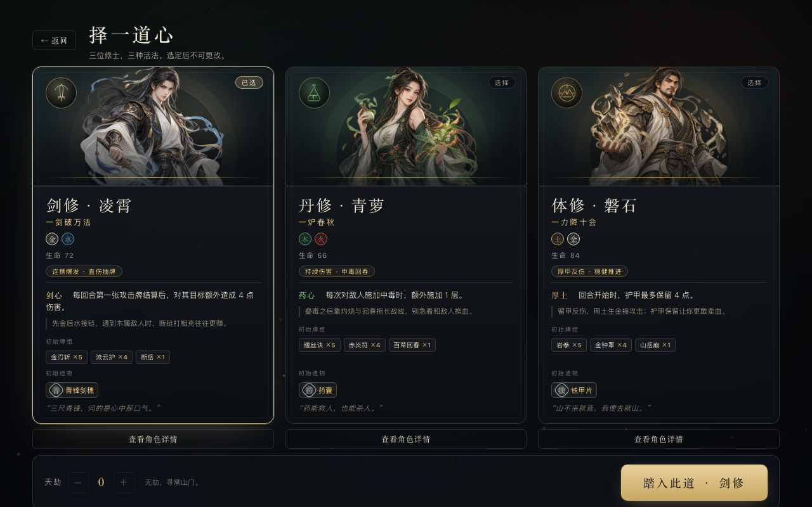
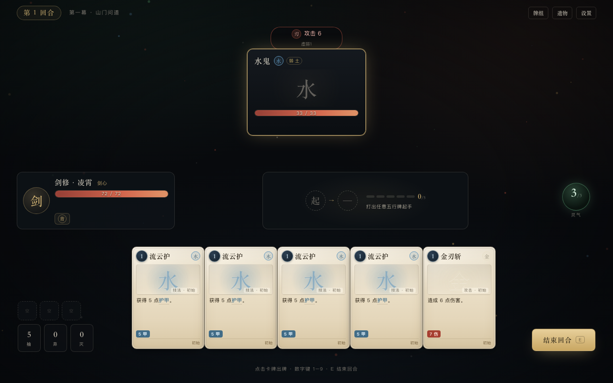
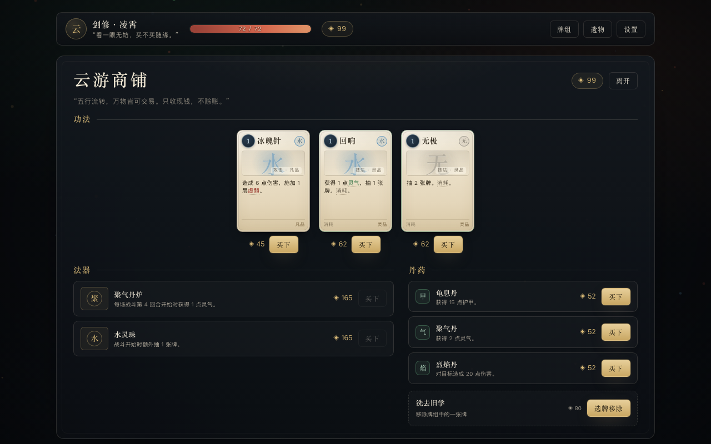

# 五行问道

一款可离线游玩的单机 **Roguelike 卡牌构筑** 小游戏。你将扮演剑修、丹修或体修，沿三幕分支地图前行，用五行相生的出牌顺序滚起连携，在「保连携」与「断链打相克」之间做取舍，最终问鼎天阙。

**纯 HTML / CSS / JavaScript，零依赖。双击 `index.html` 即玩。**



## 立即开始

1. 打开本目录。
2. 用 Chrome 或 Edge 双击 `index.html`（Safari 也可运行，但部分版本的本地存档能力可能受限）。
3. 选择一位修士，踏入第一幕。

无需安装、无需启动服务器。存档自动写入浏览器 `localStorage`，刷新或关闭后可继续。

> 桌面目标分辨率 1280×800，最低支持 1024×700；手机端针对 iPhone 15 Pro（393×852）等竖屏设备适配。

### 手机端

已适配 iPhone 15 Pro 等竖屏手机（iPhone Safari / Chrome）：

- 战斗页手牌横向滑动，结束回合独立成行，不再遮挡手牌；丹药与牌堆移到手牌上方。
- 战后奖励的三张卡牌纵向排列，直接展示完整效果与属性；点按后查看详情并确认领取。
- 点按手牌或丹药，先查看完整说明，再确认出牌或使用；点按角色、敌人、遗物也可查看详情。
- 战斗中的增益与负面状态可点开查看当前层数、完整效果和结算时机。
- 图鉴增加角色与丹药分类；已识卡牌、敌人和遗物均可点开查看完整资料。
- 地图页 HUD 折成两行，牌组 / 遗物 / 设置始终可点，地图节点放大到 64px。
- 支持刘海与 Home 指示条安全区、动态视口高度、触屏按压反馈；无横向滚动。
- 横屏未做专属布局，建议竖屏游玩。

## 核心玩法

### 灵气与手牌

每回合获得 3 点灵气，抽 5 张牌。打出卡牌消耗灵气，回合结束弃掉手牌。手牌上限 10 张。

### 相生连携（核心）

每张牌都带五行。若下一张牌正好是上一张「生」出的元素，就连携 +1：

```
木 → 火 → 土 → 金 → 水 → 木
```

- 每层连携使当前牌的伤害/护甲 +1。
- 连携会跨回合保留。
- 打错元素会断链清零，但不会额外惩罚。
- 无元素牌不改变连携。

### 五行周天

连携叠到 5 层时立即触发：

- 对所有敌人造成 8 点伤害（无视护甲）；
- 回复 1 点灵气；
- 抽 1 张牌；
- 连携归零。

### 相克破防

用克制敌人的属性攻击，伤害 ×1.5 且 **无视护甲**：

```
木克土 · 土克水 · 水克火 · 火克金 · 金克木
```

保连携，还是断链打弱点？这是每回合最重要的选择。

### 状态与关键词

中毒、灼烧按层数持续掉血；虚弱降低输出、易伤放大受伤；锐气/坚韧强化攻击与护甲；荆棘反伤、回春回复、蓄势成长。

「消耗」的牌本场不再回来；「贯穿」无视护甲；「保留」的牌回合结束不弃。

## 一局的结构

- **三幕**：山门问道 → 魔窟焚心 → 天阙归墟。
- 每幕 8 层分支地图 + 1 位幕主；战斗、精英、事件、商店、休整、宝箱六类节点。
- 战斗胜利三选一拿牌；精英掉遗物；商店可买牌/遗物/丹药，也可付费删牌；休整可疗伤或升级一张牌。
- 单局约 30–40 分钟。通关解锁「天劫」难度，最高 10 级。



## 三位修士

| 修士 | 五行 | 生命 | 被动 | 风格 |
|---|---|---|---|---|
| 剑修·凌霄 | 金 / 水 | 72 | 剑心：每回合第一张攻击牌额外造成 4 点伤害 | 连携爆发、直伤抽牌 |
| 丹修·青萝 | 木 / 火 | 66 | 药心：对敌人施加中毒时额外 +1 层 | 持续伤害、中毒回春 |
| 体修·磐石 | 土 / 金 | 84 | 厚土：回合开始护甲最多保留 4 点 | 厚甲反伤、稳健推进 |

每位角色自带 10 张初始牌与 1 件初始遗物。



## 操作

| 操作 | 方式 |
|---|---|
| 出牌 | 点击手牌；多敌人时再点击目标 |
| 快速出牌 | 数字键 `1`–`9`，对当前目标释放 |
| 结束回合 | `E` 或右下角按钮 |
| 查看牌组/遗物 | 顶部或侧栏按钮 |
| 关闭面板 | `Esc` 或点击遮罩 |
| 音效/设置/放弃 | 右上角「设置」 |
| 玩法说明 | 标题页「玩法」或设置内「玩法说明」 |



## 小技巧

- 相生链不必每回合都续；面对高护甲或高威胁敌人，断链打相克往往更赚。
- 观察敌人意图与弱点标签。敌人「弱 X」表示用 X 属性打它可破甲增伤。
- 连携跨回合保留，可以先铺一张起手牌，下回合再接完整链条。
- 周天是额外收益，不是唯一目标；为了周天放弃防御常常得不偿失。
- 删牌比拿牌更重要。把牌组压到能稳定起手、稳定续链的厚度。
- 商店的移除服务、休整的升级，都是把「能用」变成「好用」的关键。



## 内容规模

- 70 张卡牌（含 3 张诅咒、2 张特殊牌），非诅咒牌全部可升级。
- 24 件遗物（含 3 件角色初始遗物）。
- 20 种普通敌人、3 种精英、3 位幕主，全部带意图与阶段机制。
- 14 个随机事件、8 种丹药、三幕分支地图、10 级天劫。
- 图鉴、帮助、音效开关、自动存档、刷新续局。

## 开发与测试

```bash
# 规则与手机交互测试（45 项）
npm test

# 自动模拟对局：600 局，默认天劫 0
npm run sim

# 指定局数与天劫等级：300 局 · 天劫 5
node test/sim.js 300 5
```

无需 `npm install`，测试只使用 Node 内置模块。

### 文件结构

```
index.html            页面骨架
css/style.css         水墨视觉、卡牌、地图、动画
js/data.js            卡牌 / 遗物 / 敌人 / 事件 / 角色数据
js/engine.js          纯规则引擎（Node 可直接测试）
js/ui.js              屏幕渲染、交互、动画、WebAudio 音效
js/main.js            启动、localStorage 存档、全局快捷键
test/engine.test.js   规则单测
test/mobile-details.test.js  手机端详情与确认交互测试
test/sim.js           自动模拟对局
docs/screenshots/     界面截图
docs/superpowers/     设计规格与实现计划
```

### 存档

- 当前局：`wuxing_run_v1`
- 元数据：`wuxing_meta_v1`（最高天劫、图鉴、设置、统计）

在「设置 → 放弃轮回」中可清除当前局。清空站点数据会同时重置图鉴与天劫解锁。

## 设计文档

- [设计规格](docs/superpowers/specs/2026-10-17-wuxing-card-game-design.md)
- [实现计划](docs/superpowers/plans/2026-10-17-wuxing-card-game.md)

---

愿你在每一次断链与续链之间，都能看见自己的道。

## 部署到 GitHub Pages

本项目是纯静态站点，不需要构建，直接把仓库根目录发布即可。

1. 在 GitHub 新建一个空仓库（不要勾选自动生成 README），例如 `wuxing-wendao`。
2. 在本目录执行：

```bash
git remote add origin https://github.com/<你的用户名>/wuxing-wendao.git
git push -u origin main
```

3. 打开仓库 → **Settings → Pages**。
4. **Build and deployment → Source** 选择 **Deploy from a branch**。
5. **Branch** 选择 `main`，目录选择 `/ (root)`，点击 **Save**。
6. 等待 1–2 分钟，页面顶部会显示站点地址：
   `https://<你的用户名>.github.io/wuxing-wendao/`

若仓库名是 `<你的用户名>.github.io`，站点地址则是 `https://<你的用户名>.github.io/`。

注意：

- 游戏存档使用浏览器 `localStorage`，`file://` 本地打开与 GitHub Pages 属于不同来源，进度不会互通；每个域名/路径各自独立存档。
- 页面是 HTTPS 的，Chrome / Edge / Safari 均可运行；推荐 Chrome / Edge。
- 如果仓库是私有的且 Pages 入口不可用，需要将仓库改为 Public，或使用支持私有仓库 Pages 的 GitHub 计划。
- 更新游戏只需提交并推送：Pages 会自动重新发布，可能需要几十秒到几分钟。
